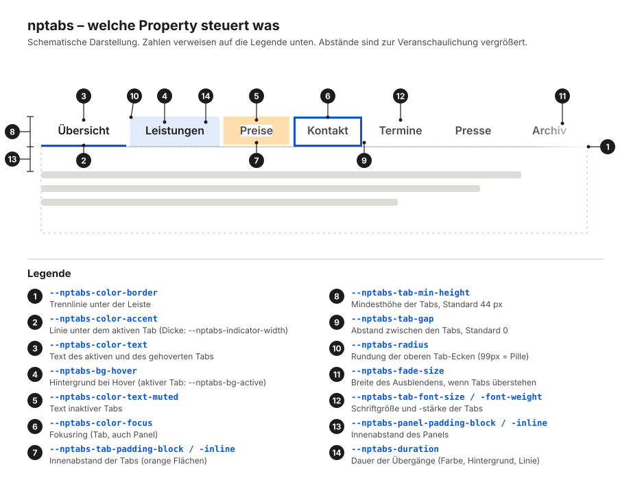

# contao-nptabs-bundle

Barrierefreie, responsive Tabs für Contao 5.7 (PHP 8.4), WCAG 2.2 AA.

- Verschachteltes Inhaltselement – genau wie das Core-Accordion: ein Element „Tabs“, darunter beliebig viele Kind-Elemente. Jedes Kind ist ein Tab, die **Abschnittsüberschrift** des Kindes ist die Tab-Beschriftung
- WAI-ARIA Authoring Practices „Tabs with Manual Activation“ (`role=tablist/tab/tabpanel`)
- Mobil: scrollbare Tab-Leiste mit Ausblend-Effekt, aktiver Tab wird in den Blick gescrollt
- Progressive Enhancement: ohne JavaScript stehen alle Inhalte mit Überschrift untereinander
- Vanilla JS (ca. 8 KB, keine Abhängigkeiten), CSS im Cascade Layer `nptabs`, SCSS zum Anpassen

## Installation (lokales Paket)

```json
// composer.json der Installation
"repositories": [{ "type": "path", "url": "bundles/contao-nptabs-bundle" }]
```

```bash
php84 composer.phar require neckarpixel/contao-nptabs-bundle:@dev
php84 vendor/bin/contao-console contao:migrate
php84 vendor/bin/contao-console cache:clear
```

`contao:migrate` legt die Felder `nptabs_label` und `nptabs_activeTab` in `tl_content` an. `public/` wird als `bundles/nptabs/` veröffentlicht (CSS + JS).

## Einrichtung im Backend

1. Inhaltselement **Tabs** (Kategorie „Verschiedenes“, neben dem Accordion) anlegen
   - Überschrift (optional), Bezeichnung der Tab-Liste (`aria-label`, leer = Überschrift), aktiver Tab beim Laden
2. Im Tabs-Element auf „Unterelemente bearbeiten“ klicken und die Inhalte als Kind-Elemente anlegen (Text, Bild, Formular, …)
3. Bei jedem Kind-Element die **Abschnittsüberschrift** ausfüllen – das ist die Tab-Beschriftung. Die Überschriften-Ebene (h1–h6) wird nur im Fallback ohne JavaScript und beim Drucken angezeigt. Ohne Eintrag heißt der Tab „Tab 1“, „Tab 2“, …

Das Feld `sectionHeadline` ergänzt das Bundle bei Kindern eines Tabs-Elements selbst in der Palette, falls der Core es nicht schon tut.

## Konfiguration

```yaml
# config/config.yaml
np_tabs:
    load_default_css: false   # Standard-CSS nicht laden, wenn das Theme alles selbst stylt
```

Alternativ im Template nur die Datei tauschen: ``.

## Tastatur & Screenreader

| Taste | Wirkung |
|---|---|
| ← / → | Fokus auf vorherigen/nächsten Tab (springt am Rand um, bei RTL gespiegelt) |
| Home / Ende | Fokus auf ersten/letzten Tab |
| Enter / Leertaste | Tab aktivieren (manuelle Aktivierung) |
| Tab | vom aktiven Tab ins Panel (Panel hat `tabindex=0`) |

- Roving `tabindex`: nur der aktive Tab ist per Tab-Taste erreichbar
- Fokusring innen (`outline-offset: -3px`), weil die scrollbare Leiste einen äußeren Ring abschneiden würde
- Tabs mindestens 44 px hoch, aktiver Tab zusätzlich über Rahmen statt nur Farbe markiert (Windows-Kontrastmodus: `Highlight`)
- `prefers-reduced-motion`: keine Übergänge, kein sanftes Scrollen
- Druck: Leiste aus, alle Panels mit Überschrift

**Deep Links:** `#nptabs-tab-<id>`, `#nptabs-panel-<id>` oder die ID eines beliebigen Elements innerhalb eines Panels öffnen den passenden Tab (beim Laden und bei `hashchange`). `<id>` ist die ID des Kind-Elements.

**Event:** `nptabs:change` (bubbles) mit `detail: { index, tab, panel }`. Nachträglich eingefügtes Markup: `window.NpTabs.init(container)`.

## Markup

```
div.nptabs[data-nptabs]
├─ div.nptabs__nav                     (data-overflow-start/-end bei überstehenden Tabs)
│  └─ div.nptabs__tablist[role=tablist]
│     └─ button.nptabs__tab[role=tab][aria-selected][aria-controls]
└─ div.nptabs__panel[role=tabpanel][aria-labelledby]
   ├─ h2.nptabs__heading               (nur ohne JS sichtbar)
   └─ div.nptabs__content
```

Template überschreibbar über `templates/content_element/nptabs.html.twig`, Blöcke: `tabs_tablist`, `tabs_tab`, `tabs_panel`. Zusätzliche Attribute über `tabs_attributes`, `tabs_nav_attributes`, `tabs_tablist_attributes`, `tabs_tab_attributes`, `tabs_panel_attributes`.

## Eigenes Styling

Nach der Installation ist das Standard-CSS sofort aktiv (`bundles/nptabs/nptabs.css`, wird nur geladen, wenn ein Tabs-Element auf der Seite liegt). Je nach Bedarf gibt es drei Wege.

### Weg 1 – Werte per Custom Properties (reicht meistens)

Im Theme-CSS die `--nptabs-*`-Properties setzen, ohne Layer:

```css
.nptabs {
    --nptabs-color-accent: #e30613;
    --nptabs-tab-padding-inline: 1.5rem;
    --nptabs-radius: 99px;
}
```

Kein Build, kein `!important`. Das Standard-CSS bleibt aktiv.

### Weg 2 – Einzelne Regeln überschreiben

Wenn Properties nicht reichen, einfache Selektoren im Theme-CSS, ebenfalls ohne Layer:

```css
.nptabs__tab[aria-selected='true'] { text-decoration: underline; }
```

Das gewinnt immer gegen das Bundle-CSS. Globale Theme-Regeln für `button` schlagen ebenfalls durch und müssen ggf. für `.nptabs__tab` zurückgesetzt werden.

### Weg 3 – Komplett per SCSS

1. Standard-CSS abschalten:

   ```yaml
   # config/config.yaml
   np_tabs:
       load_default_css: false
   ```

2. Bundle-SCSS im eigenen SCSS einbinden und Variablen setzen (`assets/scss/`: `_variables.scss` mit allen Werten als `!default`, `_tabs.scss` mit dem Mixin `styles`):

   ```scss
   @use 'pfad/zu/nptabs/assets/scss/variables' with (
       $color-accent: #e30613,
       $tab-padding-inline: 1.5rem,
       $layer: false            // false = ohne Cascade Layer ausgeben
   );
   @use 'pfad/zu/nptabs/assets/scss/tabs';
   @include tabs.styles;
   ```

   `@use … with` muss vor jedem anderen Laden der Variablen stehen.

3. Das kompilierte CSS im Theme laden.

Das mitgelieferte CSS neu bauen: `npm install && npm run build` (Dart Sass → `public/nptabs.css`).

Wer die HTML-Struktur ändern muss, kopiert `nptabs.html.twig` nach `templates/content_element/` und passt es dort an.

### Welche Property steuert was



| Nr. | Property | Standard | Wirkung |
|---|---|---|---|
| 1 | `--nptabs-color-border` | `#c4c7c5` | Trennlinie unter der Leiste |
| 2 | `--nptabs-color-accent` | `#0b57d0` | Linie unter dem aktiven Tab |
| 2 | `--nptabs-indicator-width` | `3px` | Dicke dieser Linie |
| 3 | `--nptabs-color-text` | `#1c1c1c` | Text des aktiven und des gehoverten Tabs |
| 4 | `--nptabs-bg-hover` | `rgba(11, 87, 208, 0.08)` | Hintergrund bei Hover |
| 4 | `--nptabs-bg-active` | `transparent` | Hintergrund des aktiven Tabs |
| 5 | `--nptabs-color-text-muted` | `#4a4a4a` | Text inaktiver Tabs |
| 6 | `--nptabs-color-focus` | `#0b57d0` | Fokusring von Tab und Panel |
| 7 | `--nptabs-tab-padding-block` / `-inline` | `0.75rem` / `1.25rem` | Innenabstand der Tabs |
| 8 | `--nptabs-tab-min-height` | `2.75rem` | Mindesthöhe der Tabs (44 px, Zielgröße) |
| 9 | `--nptabs-tab-gap` | `0` | Abstand zwischen den Tabs |
| 10 | `--nptabs-radius` | `0.25rem` | Rundung der oberen Tab-Ecken (`99px` = Pille) |
| 11 | `--nptabs-fade-size` | `2.5rem` | Breite des Ausblendens bei überstehenden Tabs |
| 12 | `--nptabs-tab-font-size` / `-font-weight` | `1rem` / `600` | Schrift der Tabs |
| 13 | `--nptabs-panel-padding-block` / `-inline` | `1.5rem` / `0` | Innenabstand des Panels |
| 14 | `--nptabs-duration` | `0.15s` | Dauer der Übergänge |

Die SCSS-Variablen in `_variables.scss` heißen genauso, nur ohne Präfix (z. B. `$color-accent`).

### Cascade Layer und Rangfolge

Das Standard-CSS liegt komplett im Layer **`nptabs`**. Wo eigene Regeln stehen, entscheidet über den Gewinner:

| Eigene Regeln … | Ergebnis |
|---|---|
| ohne Layer (normales Theme-CSS) | gewinnen immer, egal bei welcher Spezifität oder Ladereihenfolge |
| in einem anderen Layer, der nach `nptabs` kommt | gewinnen |
| im selben Layer `@layer nptabs { … }` | normale Regeln: Spezifität, dann Ladereihenfolge. Nicht empfohlen |

Rangfolge explizit festlegen (ganz oben im CSS): `@layer vendor, nptabs, theme;`

## Hinweise

- Verschachtelte Tabs (Tabs in Tabs) funktionieren; Hash-Links öffnen beide Ebenen
- Panel-Inhalt ist per `hidden` ausgeblendet (nicht per `display:none` im CSS), das schützt auch bei Theme-Resets
- Im Tab-Text keine Block-Elemente verwenden; die Abschnittsüberschrift ist ein einzeiliges Textfeld

## Lizenz

LGPL-3.0-or-later, siehe [LICENSE](LICENSE).
